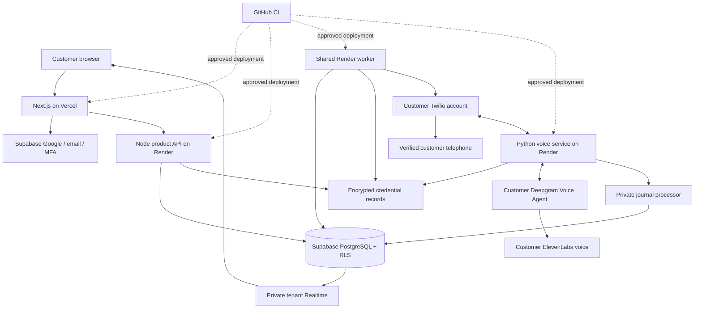
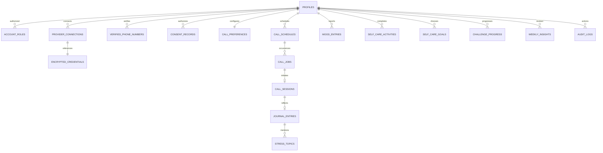

# Nila production architecture and migration

## Repository audit: 12 October 2026

The existing root is the Python uv application. main.py serves /twiml, /answer, /call-status, /audio and /media. buddy/telephony.py initiates account-aware calls. buddy/bridge.py relays 8 kHz µ-law audio, handles Deepgram functions and clears Twilio playback on interruption. buddy/phone.py implements trial Gather and Play. SQLite is authoritative for the prototype and atomic Excel writes run in the background. No Next.js, Node product API, multi-user identity, cloud scheduler or Supabase migration existed at inspection.

Earlier receipts contain an answered Gather telephone call and real managed Jessica/LLM API verification. They do not prove production bidirectional streaming or tenant isolation. The fresh baseline is 63 passing tests and two Tamil regression failures; these are recorded separately rather than representing the previous 65-test receipt as current. Whisper stays optional and outside the initial production pipeline.

Preserve the root voice application and its data. Add services/voice-python as a production adapter that reuses Twilio protocol and existing provider-schema logic. Supabase becomes the SaaS source of truth; Excel remains a legacy local export. Do not import personal prototype records into a customer account without explicit owner mapping and consent.

## Monorepo

```text
apps/web                 Next.js app and original design system
apps/api                 Authenticated TypeScript product API
services/voice-python    Tenant-bound Python Twilio/Deepgram adapter
services/call-worker     Shared durable scheduling and reconciliation
services/journal-processor Validated reflection and weekly processing
packages/shared-types    Product data contracts
packages/validation      Shared schemas and provider capability registry
packages/wellness        Browser-safe self-reported recap calculations
supabase/migrations      Schema, grants, RLS, queue and Realtime policies
supabase/tests           Tenant isolation and queue verification
.github/workflows        Local and cloud CI gates
docs/nila                Design, architecture, verification and operations
buddy, main.py, run.py    Preserved local prototype
```

## Production topology



## Entity relationships



## Trust boundaries

JWT verification establishes the owner; request bodies never select a user. RLS guards customer reads and permitted edits. Credentials are AES-256-GCM encrypted with owner/provider/reference as associated data and a versioned backend-only key. Customers only receive masked status. Service credentials never reach Next.js public variables. Administrative access requires a database role and aal2, and excludes private journal reads.

The queue atomically claims due occurrences using SKIP LOCKED, unique schedule/occurrence constraints and leases. Immediately before dialing, the worker rechecks account status, verified phone, provider state and consent. A crash after call creation moves to reconciliation, not blind redial. The Twilio Call SID binds to the owner's session. Voice endpoints verify the customer's Twilio signature and short-lived session capability. A confirmed Trial account cannot enter the Media Streams path.

Only server-created private Realtime broadcasts are emitted. Payloads carry a resource name and event, not journal text, credentials or transcripts. Topic authorization is the current user's UUID. Raw recording is off; the initial service rejects recording requests until its separate consent and retention pipeline is verified.

## Execution and deployment gates

1. Inspect baseline and preserve the working local system.
2. Deliver design tokens, route plan, architecture and migration specification.
3. Implement schema, RLS, encryption and auth.
4. Package the Python service for Render; deployment waits for project details and approval.
5. Implement shared scheduler, call reconciliation and Node APIs.
6. Build website, onboarding and authenticated product surfaces.
7. Connect journaling, mood, self-care, challenge and weekly recap.
8. Add private Realtime, MFA/admin, export and deletion.
9. Run build, security, integration and browser checks; distinguish mocked from live evidence.
10. With supplied cloud resources, approve staging deployment and an explicitly authorized real call; only then consider production.

External gates: Supabase project and backend secrets, Google OAuth, Twilio Media Streams capable customer accounts, destination verification, Deepgram/ElevenLabs access, Render/Vercel projects, GitHub remote and production approval. A continuously running Render worker is not a free web service; hosting and provider usage must be budgeted. No cloud resources have been created or deployed by this specification.
